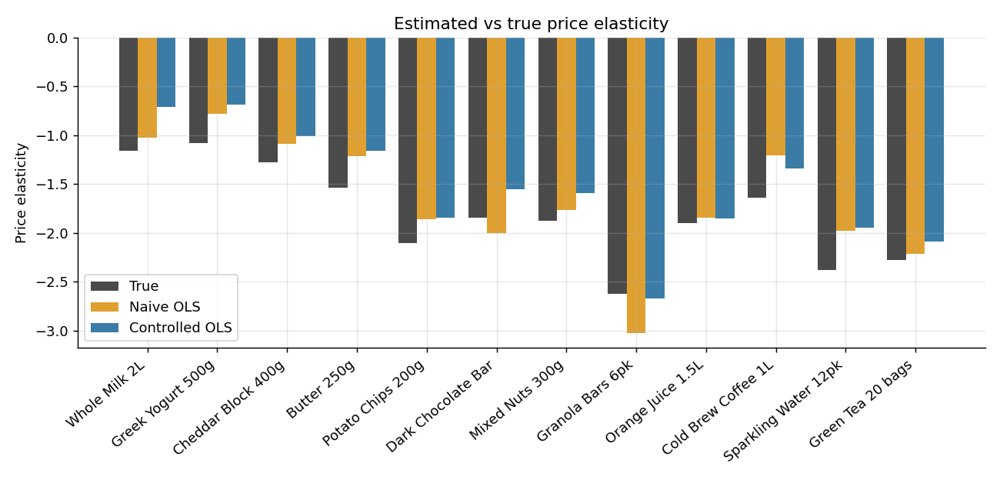
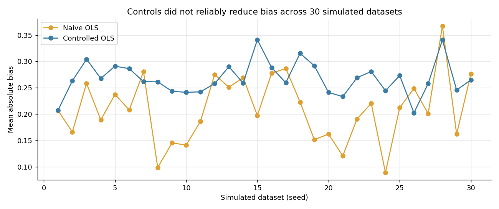
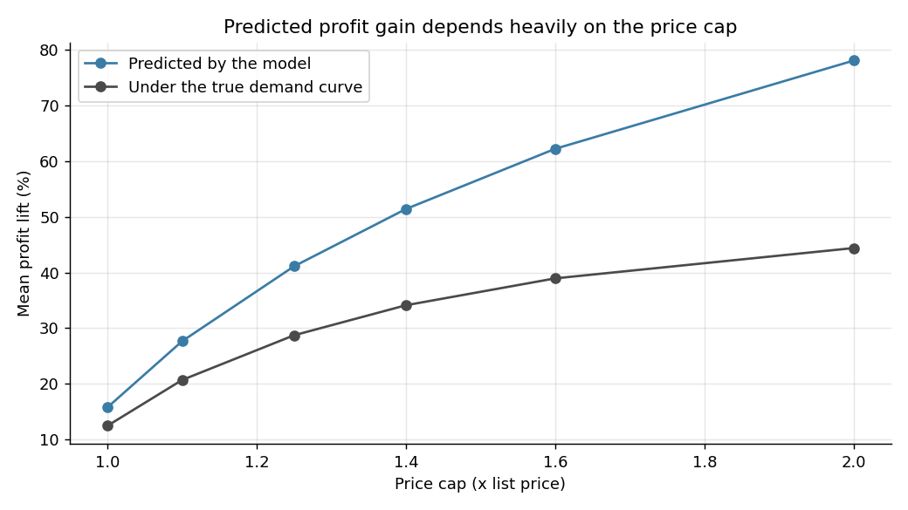

Grocery Price Elasticity & Discount Optimization
A small econometrics project: estimate how sensitive demand is to price for 12 grocery products, see how badly reactive discounting distorts those estimates, and test whether the estimates are reliable enough to set prices with.
The data is simulated (12 products, 3 categories, 130 weeks, 1,560 rows). I simulated it so that each product's true elasticity is known and I can measure the error in my estimates directly.
What I found
Discounts in the store follow weak sales weeks, and weak weeks persist (correlation of discount with last week's demand shock is about -0.22; shock autocorrelation about 0.62). Price is therefore correlated with the error term, which biases a plain regression toward "demand is not very price sensitive".
Adding controls (competitor price, holiday, seasonality) did not fix this. Across 30 simulated datasets the controlled model had lower absolute bias in only 7, and the average absolute bias was 0.27 versus 0.21 for the naive model. A likely reason is that omitting the holiday effect pushes the naive estimate the opposite way and partly cancels the endogeneity bias.
95% confidence intervals covered the true elasticity for 7 of 12 products in the main dataset and about 66% on average across seeds.
With a price cap of 1.25x list price, 8 of 12 products land on the cap, mostly the dairy staples whose elasticity is close to -1. Their predicted profit gains depend on the cap, not on the data.
Predicted profit lift (about 41%) overstates the lift under the true demand curve (about 29%).



The takeaway: elasticity estimates from observational data like this are useful for ranking products, but I would confirm with a price experiment or an instrument before acting on them.
Repository layout
```
.
├── simulate_sales.py                # builds the simulated dataset
├── elasticity_utils.py              # regression, coverage, replication, optimisation
├── price_elasticity_analysis.ipynb  # the full analysis, with outputs
├── images/                          # charts used in this README
├── data/
│   ├── weekly_sales.csv
│   └── product_catalog_true_params.csv   # true parameters, used only to check my estimates
├── requirements.txt
├── .gitignore
├── LICENSE
└── README.md
```
How it works
Simulation. Demand follows `log(units) = log(base) + e*log(price/list) + cross*log(competitor/list) + seasonality + holiday + shock`, where `shock` is AR(1). The discount each week is `0.10 - 0.12*last_week_shock + 0.05*holiday + noise`.
Estimation. Per-product log-log OLS with Newey-West (4 lag) standard errors. Naive model has log price only; controlled model adds competitor price, a holiday flag and sin/cos seasonality.
Evaluation. Bias against the true elasticities, 95% interval coverage, and a 30-seed repeat.
Optimisation. Constant elasticity demand `q = A*p^e` fitted through each product's average price and units, then maximise `(p - cost) * q` with prices capped at a multiple of list price. A sensitivity run varies the cap from 1.0x to 2.0x.
Running it
```bash
git clone https://github.com/adityays1997/Grocery_Price_Elasticity_Analysis.git
cd Grocery_Price_Elasticity_Analysis
pip install -r requirements.txt

python simulate_sales.py --seed 2024 --out data    # optional, rebuilds the CSVs
jupyter notebook price_elasticity_analysis.ipynb
```
Changing the seed changes the numbers above.
Limitations
Controls can't remove the endogeneity, and the dataset has no valid instrument.
Constant elasticity demand gives corner solutions for low-elasticity products.
Simulated data shows how the methods behave, not how a real retailer behaves.
Ideas for next steps
Try instruments such as supplier cost changes, or a randomised price test.
Try demand curves that allow interior optima (linear, logit).
Run the same pipeline on real scanner data.
Build a small Streamlit page for exploring prices.
Author
syaddanapudi
